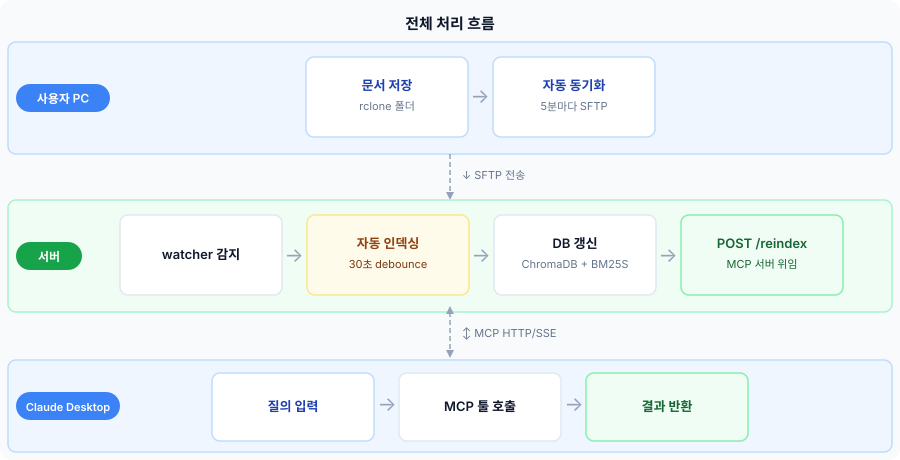
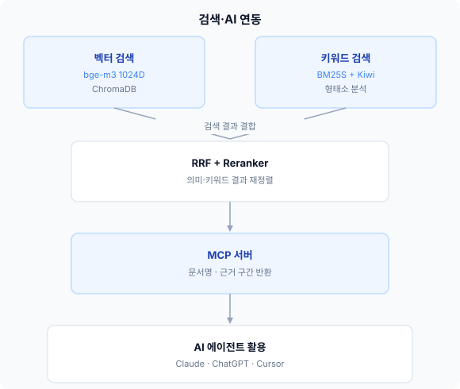

# 공유 지식 플랫폼 (Knowledge Base)

문서 자동 인덱싱 + AI 에이전트 연동 공용 docDB

---

## 목차

1. [프로젝트 개요](#1-프로젝트-개요)
2. [추진 배경 및 목적](#2-추진-배경-및-목적)
3. [주요 기능](#3-주요-기능)
4. [시스템 구조 / 처리 흐름](#4-시스템-구조--처리-흐름)
5. [설치 가이드](#5-설치-가이드)
6. [한계 및 향후 보완점](#6-한계-및-향후-보완점)
7. [요약](#7-요약)

---

## 1. 프로젝트 개요

- 여러 사람이 보유한 업무 문서를 하나의 서버에 인덱싱해 **AI 에이전트가 검색·활용**할 수 있게 하는 공용 지식 데이터베이스
- 사용자는 MCP(Model Context Protocol)로 서버에 연결하면 자신의 에이전트(Claude 등)가 docDB를 기반으로 답변·문서 초안 작성 등을 수행
- 모든 처리는 **로컬 서버에서 완결** — 외부 API·클라우드 전송 없음

| 항목 | 내용 |
|------|------|
| 배포 환경 | Ubuntu 서버 |
| 서버 사양 | i9-14900KF · RAM 62GB · RTX 4060 Ti 8GB · NVMe 1.8TB |
| 언어 | Python 3.10+ |
| MCP transport | HTTP/SSE (다중 사용자 동시 접속) |

---

## 2. 추진 배경 및 목적

- 업무 문서가 각자의 PC에 분산 → 필요한 정보를 찾는 데 시간 낭비
- 허가된 사용자들이 문서를 서버에 업로드 → **집단 지식 플랫폼**으로 성장하는 구조를 목표
- AI 에이전트가 docDB를 조회하여 기획서 초안 작성, 유사 문서 검색, 정보 요약 등 복잡한 작업을 자동화
- 민감 문서의 외부 유출 없이 사내에서 폐쇄적으로 운영

---

## 3. 주요 기능

### 문서 인덱싱

- 16개 포맷 지원: HWP, HWPX, PDF, DOCX, PPTX, XLSX, XLS, CSV, TXT, MD, HTML, HTM, RTF, Pages, Numbers, Keynote
- 증분 인덱싱 — SHA-256 해시 비교로 변경된 파일만 재처리
- **다중 루트 폴더** — 사용자별/사업별로 별도 폴더를 독립 인덱싱, 삭제 시 다른 루트에 영향 없음

### 청킹 (텍스트 분할)

- 1500 글자 단위 + 200 글자 오버랩 (한국어 특화 — 글자 단위가 어절 경계를 보존)
- 한국어 문장 종결어미(다·요·까·네·죠·시) 인식으로 자연스러운 문장 경계에서 분리
- **컨텍스트 프리픽스** 자동 주입: 각 청크 앞에 `[날짜 | 제목 | 작성자 | 파일명]` 삽입

### 하이브리드 검색

- 벡터 검색 (ChromaDB, BAAI/bge-m3 1024차원 코사인 유사도)
- 키워드 검색 (BM25S + Kiwi 형태소 분석 — 조사/어미 제거 후 의미 형태소만 추출, sparse matrix 기반 ~3GB)
- **RRF (Reciprocal Rank Fusion)** 병합 — 순위 기반 통합, 점수 스케일 차이에 영향 없음
- **문서 단위 중복 제거** — 같은 파일에서 청크가 여러 개 나와도 최고점 1개만 반환
- Cross-encoder Reranker (BAAI/bge-reranker-v2-m3) — 최종 상위 10개 정밀 재순위

### MCP 서버 툴 (5개)

| 툴 이름 | 설명 | 주요 파라미터 |
|---------|------|--------------|
| `search_knowledge` | 하이브리드 검색 (폴더·파일명·날짜 필터, latest_only) | `query, top_k, folder, file_filter, date_from, date_to, latest_only` |
| `get_document` | 파일 전체 내용 조회 (페이지네이션 지원) | `file_path, chunk_offset, chunk_limit` |
| `list_documents` | 인덱싱된 문서 목록 | `folder, extension, sort_by, limit` |
| `reindex` | 지정 폴더 증분 업데이트 | `folder_path` |
| `get_stats` | 인덱스 현황 통계 | — |

---

## 4. 시스템 구조 / 처리 흐름

### 전체 처리 흐름



### 검색·AI 연동



### 폴더 구조

```
knowledge-base/
├── config.yaml          # 전체 설정 (청킹, 임베딩, 검색, MCP 포트 등)
├── config.py            # YAML 로딩 및 상수 노출
├── main.py              # CLI 진입점 (index / search / mcp / watch / delete)
├── pipeline.py          # 인덱싱 파이프라인
├── parsers/             # 포맷별 파서 (PDF, HWP, DOCX 등)
├── indexer/
│   ├── chunker.py       # 한국어 글자 단위 청킹 + 컨텍스트 프리픽스
│   ├── embedder.py      # BAAI/bge-m3 임베딩
│   ├── vector_store.py  # ChromaDB 래퍼
│   ├── bm25_index.py    # BM25S + Kiwi 형태소 분석 + RWLock
│   ├── incremental.py   # SQLite 증분 인덱싱
│   └── metadata.py      # 메타데이터 추출
├── search/
│   ├── hybrid.py        # RRF 병합 + 문서 단위 dedup + latest_only
│   └── reranker.py      # Cross-encoder reranker
└── mcp_server/
    └── server.py        # MCP HTTP/SSE 서버 (5개 툴)
```

### 인덱싱 흐름

```
watcher 파일 감지 → POST /reindex → MCP 서버 background thread
  → 폴더 스캔 + 변경 파일 감지 (SHA-256)
  → 파서로 텍스트 추출
  → 메타데이터 추출 (파일시스템 + 문서 내장 속성 + 첫 줄 패턴)
  → 글자 단위 청킹 + 컨텍스트 프리픽스 주입
  → BAAI/bge-m3 임베딩 (배치)
  → ChromaDB 저장 + bm25_tokens SQLite 저장 + file_index 해시 기록
  → 5분 debounce 후 BM25S rebuild_and_swap (atomic swap)
```

### 검색 흐름

```
쿼리 입력
  → 벡터 검색 (상위 50개) + BM25S 검색 (상위 50개, RWLock read)
  → RRF 병합 (순위 기반 통합)
  → 폴더/파일명 필터 (post-filter)
  → 문서 단위 중복 제거 (파일별 최고점 1개)
  → active 필터 (삭제 파일 잔존 청크 제거)
  → Reranker (상위 10개 정밀 재순위)
  → 최종 top_k 반환
```

### 주요 설정값 (config.yaml)

| 항목 | 값 | 비고 |
|------|-----|------|
| 임베딩 모델 | BAAI/bge-m3 | 1024차원, 로컬 실행 |
| 청크 크기 | 1500 글자 | 오버랩 200 글자 |
| 벡터/BM25 top_k | 각 50 | RRF 입력 |
| RRF k 파라미터 | 60 | |
| Reranker | 활성화 | BAAI/bge-reranker-v2-m3, 최종 top_k=10 |
| MCP 포트 | 8000 | host: 0.0.0.0 |

---

## 5. 설치 가이드

### 서버 설치 (관리자)

**요구 사항:** Ubuntu 20.04+, Python 3.10+, CUDA GPU 권장

```bash
# 1. 코드 클론
git clone https://github.com/janghyeonseo0130/knowledge-base.git
cd knowledge-base

# 2. 가상 환경 + 패키지 설치
python3 -m venv .venv
source .venv/bin/activate
pip install -r requirements.txt

# 3. HuggingFace 모델 다운로드 (최초 1회, 인터넷 연결 필요)
python -c "from FlagEmbedding import FlagModel; FlagModel('BAAI/bge-m3')"
python -c "from FlagEmbedding import FlagReranker; FlagReranker('BAAI/bge-reranker-v2-m3')"

# 4. config.yaml 수정
#    paths.uploads_dir  — 팀원 파일 수신 폴더 경로
#    mcp.host / mcp.port — 서버 바인딩 주소·포트 (기본 0.0.0.0:8000)

# 5. MCP 서버 시작
python main.py mcp

# 6. watcher 시작 (별도 터미널)
python main.py watch /경로/to/uploads
```

**systemd 서비스 등록 (자동 재시작)**

```bash
sudo systemctl enable --now knowledge-base-mcp
sudo systemctl enable --now knowledge-base-watcher
```

> 서비스 파일 위치: `/etc/systemd/system/knowledge-base-mcp.service`, `knowledge-base-watcher.service`

---

### 팀원 PC 설정 (사용자)

**1단계 — 파일 동기화 설정**

관리자에게 `rclone.zip`을 받아 압축 해제 후 설정합니다. (Confluence 세미나 페이지에 업로드되어 있습니다.)

| OS | 사전 준비 | 설정 파일 | 수정 항목 | 실행 |
|----|-----------|-----------|-----------|------|
| Windows | 없음 (rclone.exe 포함) | `sync.bat` | `MY_NAME`, `LOCAL_FOLDER` | `install.bat` 관리자 권한 실행 |
| Mac | `brew install rclone` | `sync.sh` | `MY_NAME`, `LOCAL_FOLDER` | `bash install.sh` |

설치 완료 후 **5분마다 백그라운드에서 서버로 자동 동기화**됩니다.

**2단계 — Claude MCP 연결**

**Claude Code:**
```bash
claude mcp add knowledge-base --transport sse http://서버IP:8000/sse
```

**Claude Desktop** (`claude_desktop_config.json`):
```json
{
  "mcpServers": {
    "knowledge-base": {
      "url": "http://서버IP:8000/sse",
      "transport": "sse"
    }
  }
}
```

설정 후 Claude에게 **"지식베이스에서 [검색어] 찾아줘"** 라고 하면 바로 검색됩니다.

---

## 6. 한계 및 향후 보완점

### 현재 한계

- **ChromaDB 스케일:** 수백만 청크에서 성능 저하 가능. 장기적으로 Qdrant 교체 검토 (BM25S 교체로 RAM 문제는 해결됨)
- **이미지 파일 인덱싱 미지원:** .jpg .png 등 이미지 파일 자체는 인덱싱 제외 (docx/pptx 내 삽입 이미지는 OCR 지원)
- **동시 쓰기 안전성:** SQLite는 다중 사용자 동시 인덱싱 시 충돌 가능 → 사용자 수 증가 시 PostgreSQL 전환 필요

### 향후 보완 방향

- 문서 레이어(요약 + 메타데이터 태깅) 추가 — 에이전트가 문서 단위로 먼저 탐색한 뒤 세부 청크 조회하는 2단계 검색
- 사용자별 접근 권한 관리 — 1단계: SFTP chroot 격리, 2단계: MCP 인증 레이어
- 이미지 파일(.jpg .png 등) 직접 인덱싱 — 현재 제외, 팀 필요 시 추가 검토

---

## 7. 요약

| 구분 | 내용 |
|------|------|
| 무엇을 하는가 | 업무 문서를 자동 인덱싱하고 AI 에이전트가 MCP로 검색·활용하는 공용 지식 서버 |
| 누가 쓰는가 | 허가된 내부 사용자, 각자의 AI 에이전트를 통해 접근 |
| 핵심 기술 | BAAI/bge-m3 임베딩 + BM25S(Kiwi) + RRF + Cross-encoder Reranker + ChromaDB + FastMCP |
| 차별점 | 한국어 특화 청킹, 컨텍스트 프리픽스, 문서 단위 dedup, 다중 루트 독립 관리 |
| 현재 단계 | 청커 4단계 경계 재설계·배치 임베딩·greedy merge 구현 완료 (2026-09-18). 다음: xlsx 2단계 sheet 처리 구현 → 전체 재인덱싱 → 팀원 배포 |
| 남은 과제 | 팀 배포, 대규모 성능 검증, 문서 레이어 설계, 권한 관리 |
